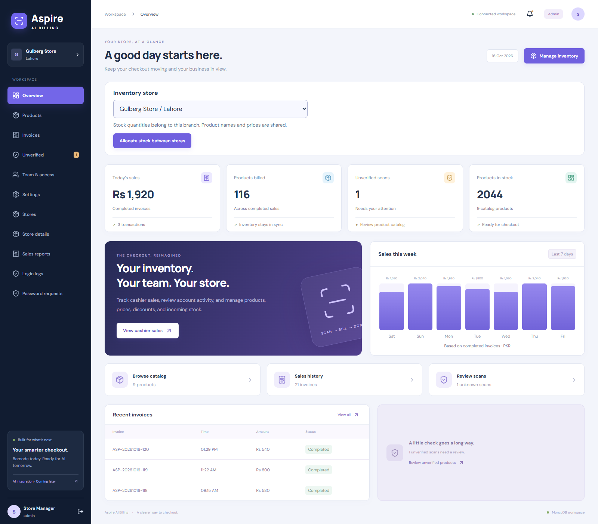
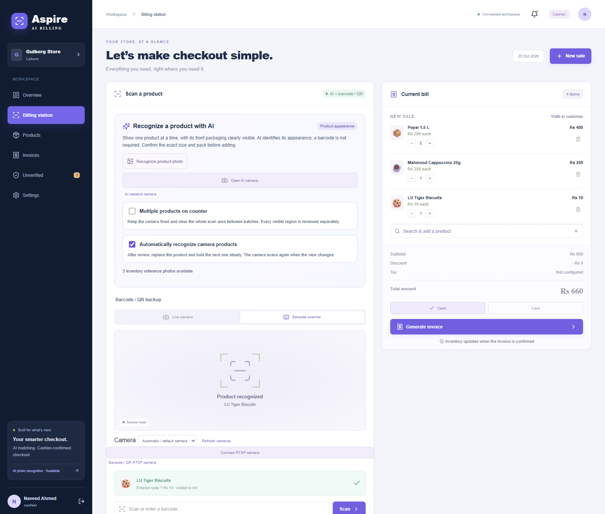
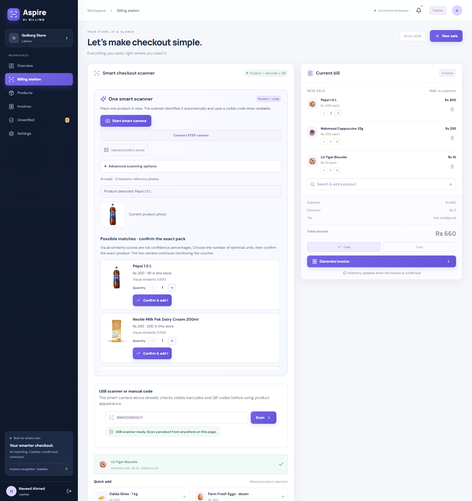
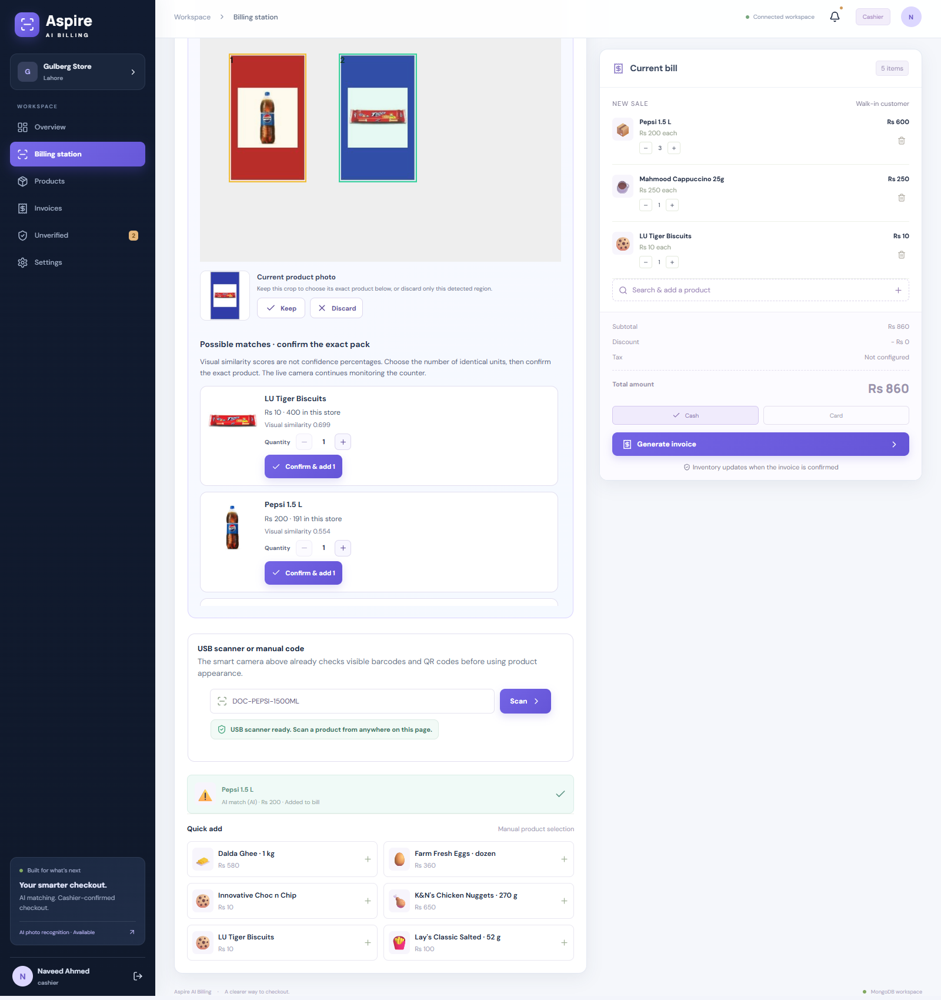
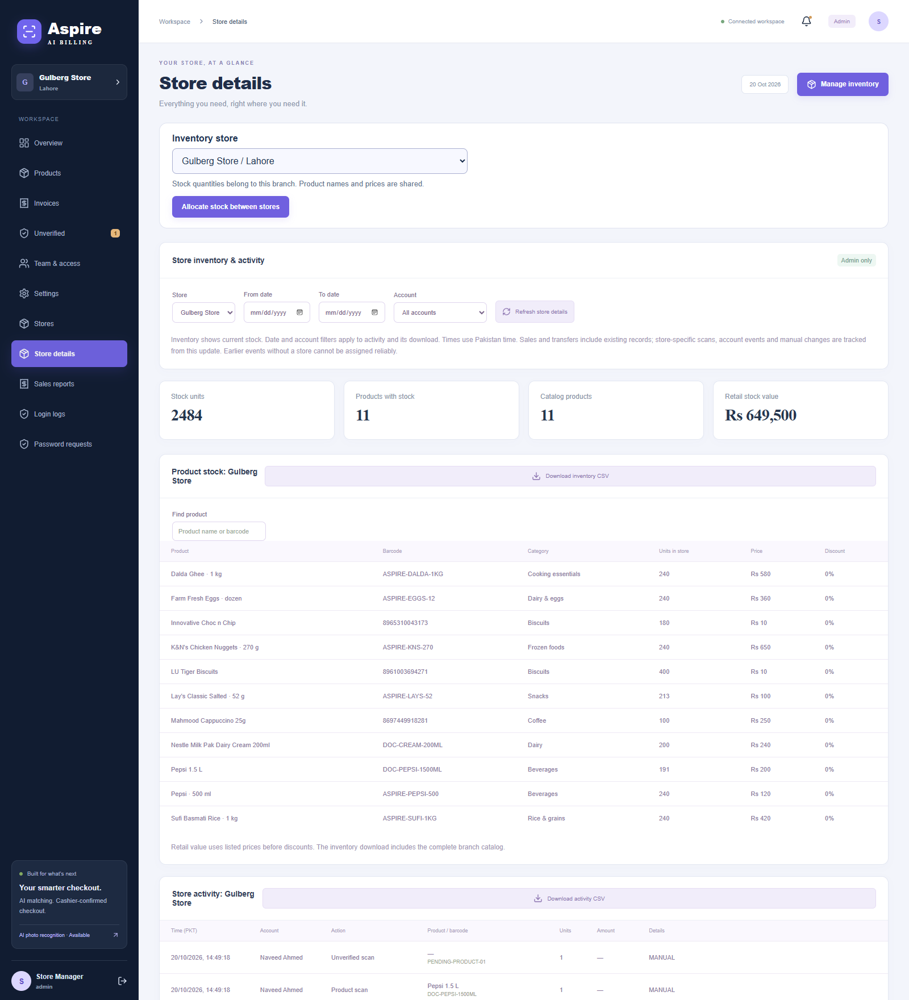
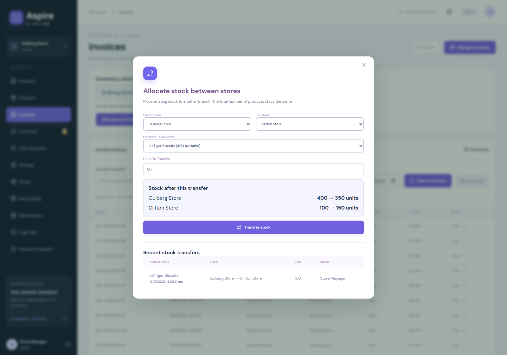
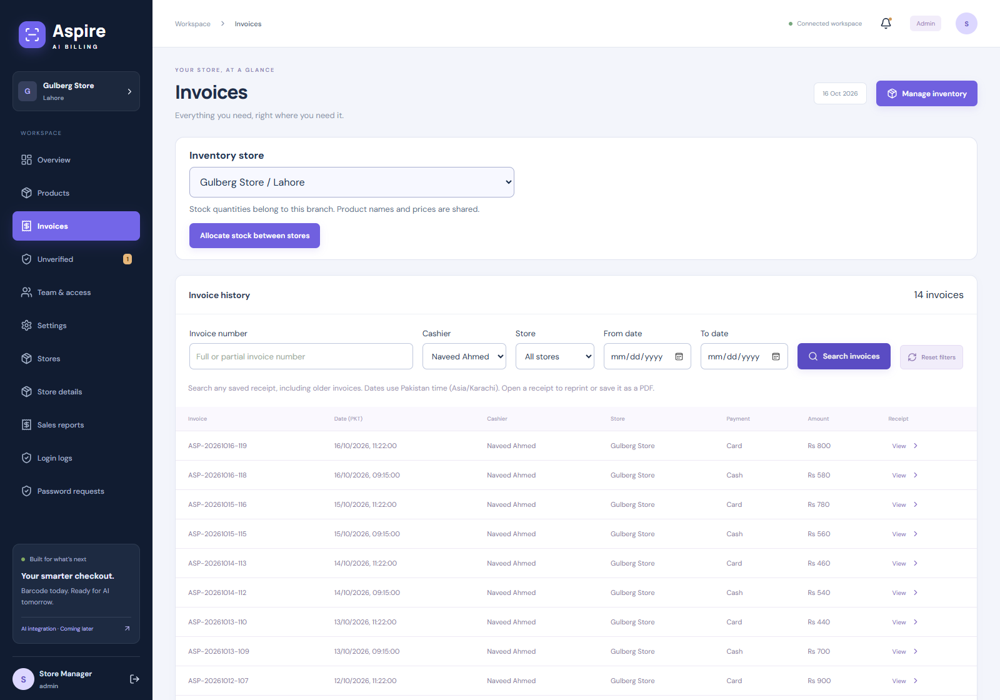
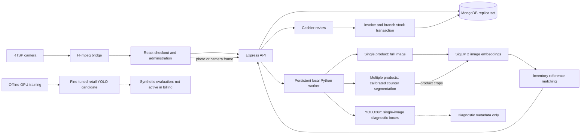

# VisionCart AI

### Aspire AI Billing - retail checkout and branch inventory

A full-stack retail application for cashier-assisted product recognition, billing, inventory, and store administration. Product prices and stock come from MongoDB; local vision models suggest inventory products for cashier review.

**React 19 | Vite | Express 5 | MongoDB | Python | SigLIP 2 | YOLO26**



## What the application does

| Area | Capabilities |
| --- | --- |
| Checkout | Barcode and QR scanning, USB scanners, product search, editable quantities, discounts, and cash/card recording |
| AI recognition | Local reference-photo matching, current branch prices and stock, and cashier-confirmed product selection |
| Camera inputs | Webcam and RTSP capture, automatic capture after the scene changes, and an optional empty-area calibration |
| Multiple products | Separate regions on a calibrated, fixed counter; individual review for each crop; repeated SKUs merge into the same bill row |
| Inventory | Shared product details, separate store quantities, restocking, and audited stock transfers |
| Administration | Stores, cashier access, temporary-password resets, account activity, and reset-request handling |
| Reporting | Invoice search, reprints and PDF through browser printing, store reports, sales filters, and CSV exports |
| Catalog tools | Resumable retailer extraction, source provenance, duplicate-photo checks, controlled imports, and cached reference indexing |

**Operational boundary:** AI matches require cashier confirmation. The current multi-product app mode uses calibrated foreground segmentation and needs visible gaps between items. The separately trained YOLO detector is an experimental candidate; the billing app does not activate it automatically. Hidden bottles, dense stacks, touching products, unknown SKUs, and visually similar pack sizes are not reliably resolved.

## Application screenshots

Screenshots use fictional accounts, sample prices, and an isolated temporary database. The multi-product scene is a generated three-product fixture, not a physical-camera accuracy demonstration.

### Cashier checkout



### AI photo recognition



### Multiple-product review



<details>
<summary>Store inventory, stock allocation, and invoice history</summary>

| Store inventory and activity | Stock transfer preview |
| --- | --- |
| [](docs/screenshots/store-details.png) | [](docs/screenshots/stock-transfer.png) |



</details>

## Quick start

**Requirements:** Node.js 20.19+ and a MongoDB replica set or MongoDB Atlas deployment. Python and downloaded model weights are optional for barcode-only workflows and required for AI recognition.

```powershell
npm.cmd ci
Copy-Item .env.example .env
# Configure MONGODB_URI and a random JWT_SECRET of at least 32 characters.
npm.cmd run dev
```

Open **http://127.0.0.1:5173/**. The API runs on port **4000**. A guest demo is available without database authentication; connected accounts use persisted inventory and invoices.

- MongoDB transactions require a replica set. See [local MongoDB setup](docs/OPERATIONS.md#local-mongodb).
- Public signup and first-admin self-registration are disabled. Existing administrators provision accounts; use a controlled local bootstrap for the first administrator.
- Cameras require browser permission and localhost or HTTPS.
- Copying the example configuration does not create accounts or import the retailer library.

For a production build served by Express:

```powershell
npm.cmd run build
npm.cmd start
```

Open **http://127.0.0.1:4000/**. HTTPS, deployment secrets, backups, and operational monitoring must be configured for the target environment.

## AI setup

1. Prepare a Python environment containing PyTorch, Transformers, Ultralytics, Pillow, OpenCV, and NumPy. The default interpreter is `.venv-ai/Scripts/python.exe` on Windows; set `AI_PYTHON_PATH` for another environment.
2. Download YOLO26n to `models/detector/yolo26n.pt` and the complete SigLIP 2 checkpoint to `models/siglip2/`. Follow the [model setup guide](models/README.md).
3. Register exact inventory products and add reference images under **Products > AI photos**, or review and import a local retailer snapshot.
4. Choose **Recognize product photo**, **Open AI camera**, or **AI network camera**. Confirm each product and exact pack size before adding it to a bill.
5. For multi-product capture, enable **Multiple products on counter**, save an empty-counter image, and place separated items fully in view. Clear the complete area between batches.

The backend starts a persistent local Python worker on first use. Model loading makes the first request slower. Similarity scores are cosine similarities, not calibrated confidence percentages. Unknown products may still resemble known references.

See [AI recognition and camera behavior](docs/AI-RECOGNITION.md) and [retail catalog import](docs/RETAIL-LIBRARY-IMPORT.md).

## GPU training and measured limits

An experimental one-class retail detector was fine-tuned locally on an **RTX 4050 Laptop GPU with 6 GB VRAM**. The dataset contained **900 synthetic scenes from 160 catalog photos**, with source-disjoint training, validation, and test splits. Training stopped early after 24 epochs; test results compare the selected checkpoint with class-agnostic generic YOLO detections.

| Metric on 180 synthetic test scenes | Original YOLO | Fine-tuned candidate |
| --- | ---: | ---: |
| Precision | 72.6% | 91.6% |
| Recall | 60.0% | 86.8% |
| Detection mAP at IoU 0.5 | 70.6% | 93.4% |
| Detection mAP at IoU 0.5-0.95 | 57.3% | 77.6% |

These measure locating product boxes, not exact-SKU recognition or real checkout accuracy. On the earlier 32-product synthetic stress set, the candidate located 29/32 touching items and 23/32 overlapping items, but also produced extra boxes. It remains unsuitable for unattended counting. SigLIP weights were not fine-tuned.

Training scripts, source-split rules, results, and remaining failure cases are documented in [GPU training](docs/GPU-DETECTOR-TRAINING.md) and the [evaluation summary](docs/MODEL-EVALUATION.md). Model weights and generated training data remain local rather than being committed to Git.

## Architecture



YOLO26n currently supplies diagnostic boxes for single-product requests; SigLIP 2 matches the full image in that mode. Multi-product requests use calibrated counter segmentation to produce crops for SigLIP 2. The separately fine-tuned YOLO candidate remains an offline experiment and is not connected to the billing detection path.

MongoDB owns prices, discounts, stock, and invoice records. AI returns candidate product identities; it does not determine prices. Each region prediction is user/store-bound, expires, and can be confirmed only once.

## Verification

```powershell
npm.cmd test                 # Billing, camera-cycle, RTSP, matching, and catalog unit tests
npm.cmd run build            # Frontend production build
npm.cmd run test:e2e         # Application workflows
npm.cmd run test:dataset     # Dataset-backed application checks
npm.cmd run test:ai          # Real local inference and billing integration
.\.venv-ai\Scripts\python.exe scripts/test-scene-regions.py
```

Browser suites use Microsoft Edge and isolated test databases. AI/data suites also require the local dataset and model files. Controlled webcam/RTSP frames test integration; they do not validate physical hardware or network-camera performance. See [verification and evidence](docs/MODEL-EVALUATION.md).

To reproduce the documentation screenshots after building:

```powershell
npm.cmd run screenshots -- dashboard billing store-details invoice-search stock-transfer ai-recognition multi-product
```

AI screenshots require the local reference dataset and model weights. The capture script creates fictional accounts and removes its temporary database afterward.

## Project layout

```text
src/          React interfaces, camera capture, and scan-cycle handling
server/       Express routes, inventory rules, model worker, and matching
shared/       Catalog defaults and shared price calculations
scripts/      Catalog extraction/import, benchmarks, GPU training, screenshots
tests/        Browser workflows and fixtures
docs/         Operations, feature guides, evaluation, and screenshots
models/       Model documentation; downloaded/trained weights are ignored
datasets/     Dataset documentation; generated snapshots/images are ignored
```

## Documentation

- [Setup, accounts, stores, and operations](docs/OPERATIONS.md)
- [AI recognition and multi-product usage](docs/AI-RECOGNITION.md)
- [Retail extraction and import](docs/RETAIL-LIBRARY-IMPORT.md)
- [Model setup](models/README.md)
- [GPU training](docs/GPU-DETECTOR-TRAINING.md)
- [Evaluation results and limitations](docs/MODEL-EVALUATION.md)
- [Project roadmap](docs/PROJECT-README.md)
- [Per-file change notes](docs/CHANGELOG.md)

Currency is **PKR (Rs)**. Card payment processing, automatic tax calculation, and Odoo integration are not implemented. Retailer listing IDs and generated internal catalog codes are not verified manufacturer barcodes. Review upstream model licenses and dataset permissions for your intended distribution and deployment.
