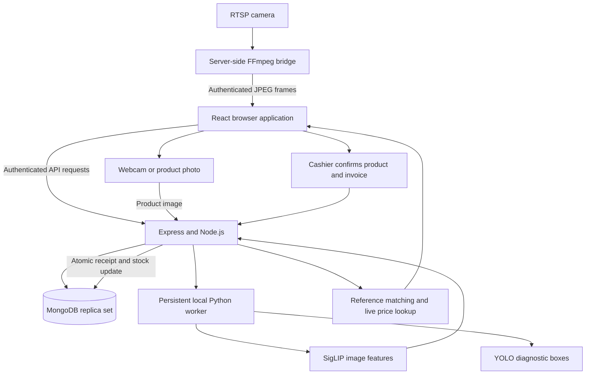
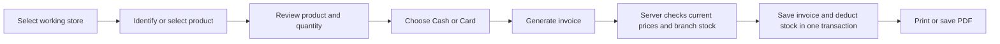

# Aspire AI Billing: complete project overview

**Implementation snapshot: 20 October 2026.**

Application name: **Aspire AI Billing**. Existing project folder: **VisionCart AI**. The folder name has not changed.

## 1. Project purpose

Aspire AI Billing combines assisted retail checkout, inventory for individual branches, employee access and business reporting. Its goal is to identify a product, retrieve its actual inventory record and price, let a cashier confirm the purchase, and save a receipt while deducting stock from the correct store.

The application supports single-product AI matching and calibrated multi-product scenes with separately reviewed crops, plus barcode/QR and manual selection. A synthetic-data YOLO candidate has been trained independently; reliable physical multi-product recognition and automatic quantity estimation remain unvalidated.

## 2. System architecture



| Layer | Technology | Responsibility |
| --- | --- | --- |
| Frontend | React, Vite, CSS, Lucide icons | Dashboard, scanning, checkout, administration and reports |
| API | Node.js, Express | Authentication, permissions, validation and business rules |
| Database | MongoDB, Mongoose | Users, products, branch stock, invoices, photos and audit events |
| Authentication | bcryptjs, JSON Web Tokens | Password hashing and authenticated sessions |
| Printed-code recognition | ZXing browser/library packages | Barcode and QR decoding |
| Product image recognition | Python, PyTorch, Transformers | Local SigLIP image features |
| Object detection | Ultralytics YOLO26n | Diagnostic detections; product-specific localization is not validated |
| Network cameras | FFmpeg | Convert reachable RTSP streams into browser-readable images |
| Browser verification | Playwright, Microsoft Edge | Application workflows and controlled camera tests |

The MERN application is the main system. Python is a supporting local inference process; it does not replace the Express API or MongoDB.

## 3. Roles and permissions

| Capability | Administrator | Cashier |
| --- | --- | --- |
| Create additional administrators | Yes | No |
| Create cashiers with temporary passwords | Yes | No |
| Deactivate/reactivate cashiers or reset access | Yes | No |
| Review password requests and login logs | Yes | No |
| Add/edit products, prices, discounts and AI photos | Yes | No |
| Add stores or change active status | Yes | No |
| Restock and transfer stock | Yes | No |
| View store details and export branch activity | Yes | No |
| View sales across cashiers and stores | Yes | No |
| Scan products for sales and create invoices | No | Yes |
| Choose a persistent working store | No cashier-style store selection | Yes |
| Search saved invoices | All invoices | Own invoices only |
| Profile photo and logout | Yes | Yes |

Public signup and administrator self-registration are disabled. Permissions are enforced by the backend as well as the interface.

### Account lifecycle

1. An administrator creates a cashier and supplies a temporary password.
2. The cashier signs in using the correct role tab.
3. The application requires a different password before allowing normal work.
4. Password changes increment the token version, invalidating older sessions.
5. Deactivation blocks access while preserving the account and historical sales.
6. Reactivation restores access; resetting an inactive account does not reactivate it.

**Forgot password:** a cashier submits a request, the administrator receives a queue item and bell notification, and the administrator assigns a temporary password. The cashier replaces it at sign-in. This is an administrator-reviewed workflow, not email-based recovery.

JWTs expire after eight hours. Logout clears the browser session and records an event; server-side token revocation occurs through token-version changes, account controls or expiry rather than logout alone.

## 4. User interface and navigation

| Screen | Main functions |
| --- | --- |
| Overview | Sales and stock summaries, recent invoices, alerts and shortcuts |
| Billing station | AI input, barcode/QR backup, current bill, quantities, payment selection and invoice creation |
| Products | Name/code search, prices, stock and product selection; admin editing, restocking and AI photos |
| Invoices | Search, cashier/store/date filters, pagination, opening and reprinting receipts |
| Unverified | Review unknown printed codes and rejected AI photo events |
| Team & access | Administrator account creation and cashier access controls |
| Profile & photo | Profile picture, name initial fallback and persistent cashier working-store choice |
| Stores | Administrator store creation, status control and entry to branch details |
| Store details | Branch inventory, action history, filtering and CSV export |
| Sales reports | Cashier/product/day/store sales summaries |
| Login logs | Account activity and sign-in results |
| Password requests | Administrator review of cashier recovery requests |
| Settings | Current application configuration guidance and scope |

The profile/avatar menu includes logout. Missing profile photos fall back to the first letter of the user's name. Store selection remains saved across logins until the cashier changes it. Changing stores clears an unfinished bill after confirmation.

The product catalog initially displays 60 matching entries, supports loading more, and searches the full loaded catalog. Notifications cap the displayed low-stock entries and provide a route to the full catalog.

### Demo and connected modes

The guest demo stores sample products, invoices and scan events in browser storage. Signed-in accounts use the authenticated Express API and MongoDB. A guest demo operation is not a live database sale.

## 5. Checkout and invoice processing



- Products can enter a bill through a confirmed AI suggestion, an exact barcode/QR match or manual selection.
- Cashiers can remove an incorrect item and increase or decrease quantities.
- AI suggestions never add a product without confirmation.
- Unknown codes and rejected AI suggestions do not enter the bill.
- The server calculates prices and discounts from inventory records, rather than trusting submitted browser prices.
- Duplicate invoice lines merge by product ID. Quantities must be valid positive whole numbers.
- Stock is checked in the cashier's active working store. Out-of-stock items cannot be billed.
- MongoDB transactions keep invoice creation and stock deductions together and protect concurrent sales from overselling.
- A failed transaction does not leave a successfully saved receipt with a partially deducted bill.

Invoices snapshot product names, barcodes, unit prices, discounts, quantities, cashier information and store details. Later catalog or profile changes do not rewrite the original receipt.

**Pricing:** amounts use Rs/PKR. Discounts are percentages on individual products, calculated with cent rounding. Tax is not configured. Cash/Card is a recorded payment method; no payment gateway charges a card.

## 6. Barcode and QR scanning

| Input | Behavior |
| --- | --- |
| USB handheld scanner | Types a code into the focused barcode field |
| Webcam or phone-as-webcam | Browser camera stream decoded with ZXing |
| Uploaded barcode/QR image | Decoder reads the printed code from the image |
| RTSP backup camera | Browser decodes JPEG frames supplied by the server bridge |
| Manual code entry | Exact inventory-code lookup |

Barcode and QR format detection is automatic. QR content must match a stored product code; an unrelated web link does not become a product automatically. Live code scanning suppresses repeated reads of the same stationary code until the cashier requests the next unit.

Internal `ASPIRE-...` and `RETAIL-...` identifiers are not manufacturer EANs. Admins can enter the real code printed on an exact pack. Physical reading quality depends on focus, distance, lighting, glare and code resolution.

## 7. AI product recognition

### Current implemented flow

1. An administrator attaches reference pictures to an exact MongoDB product, or runs the retailer bulk import.
2. The local image encoder creates a normalized 768-dimensional vector for each picture.
3. A cashier uploads a picture or opens an AI webcam/RTSP input.
4. The local worker encodes the new product image.
5. Express compares that vector with the reference library using cosine similarity.
6. The best reference per product is used to rank products.
7. The API returns up to three verified candidates with their reference pictures, current prices and branch stock.
8. The cashier confirms the exact size and pack, or rejects all suggestions.

### Model responsibilities

| Component | Current use | What it does not currently guarantee |
| --- | --- | --- |
| SigLIP 2 base | Match the complete single-product image against reference vectors | Perfect identification of every Pakistani SKU or an unseen product |
| YOLO26n | Produce diagnostic object boxes | Reliable product crops, multiple-product checkout or automatic quantities |
| MongoDB | Provide product IDs, prices, discounts and branch stock | Recognition from an unregistered product name alone |
| Cashier | Confirm identity and quantity | Unattended checkout |

**Prices are database data, not knowledge trained into either model.** Changing a product price does not require training or re-encoding its image.

The displayed visual similarity is not a calibrated confidence percentage. Unknown products can resemble registered products and receive suggestions. There is no validated automatic unknown-rejection threshold.

### Camera automation and safeguards

- Automatic camera recognition analyses a frame when the library and camera are ready.
- It pauses while suggestions are reviewed, then monitors the camera for a changed, steady view.
- **Scan next product** is a manual override. Empty-area calibration helps rearm after removal and suppress empty-counter suggestions.
- Manual capture remains available.
- RTSP capture uses an independently decoded frame, not an image currently reloading in the preview.
- Capture is disabled before the first usable frame and recovers when a valid frame follows an unreadable one.
- Confirmation checks prediction ownership, selected store, expiry, current price and current stock.
- Predictions expire after five minutes and cannot be confirmed twice.
- Rejection creates an unverified AI scan event without charging an item.

### Runtime details

- Weights: `models/detector/yolo26n.pt` and `models/siglip2/`.
- A persistent Python subprocess starts lazily; no separate inference-server command is required.
- The local runtime does not need a cloud AI API key and loads the prepared weights offline.
- The unused SigLIP text tower is released because this service uses image features.
- The worker uses CPU inference; startup can make the first request slower.
- The reference index uses compact vectors, coalesces index loads and refreshes after 15 seconds. Admin photo changes invalidate it immediately.
- Product prices and stock are read from live records after ranking, not cached as part of the visual index.
- Manual reference enrollment supports up to eight images per exact product.

Adding reference images is **indexing**, not fine-tuning. A separate YOLO candidate was fine-tuned on synthetic foreground-mask boxes. Deployment still requires reviewed physical checkout labels and independent evaluation; see [GPU training](GPU-DETECTOR-TRAINING.md).

## 8. Cameras and RTSP

The camera picker enumerates browser-visible cameras, supports manual selection, refreshes on device changes and remembers preferences. Supported external-device labels can be preferred automatically. Phone software such as DroidCam works only when its virtual camera is exposed to the browser and supplies usable frames.

Browser webcam access requires localhost or HTTPS and permission. A green or unreadable virtual-camera feed is a capture/driver issue; the application cannot reconstruct missing video detail.

### Network-camera path

```text
Reachable camera RTSP stream
  -> FFmpeg on the backend computer
  -> JPEG frame endpoint protected by account authentication
  -> Browser preview
  -> AI recognition or barcode/QR backup
```

- Direct camera addresses currently use RTSP with an IPv4 address.
- The backend computer must be able to reach that address. Remote home/office access needs suitable network connectivity, such as a VPN; a private home IP is not automatically reachable from another network.
- The browser does not open RTSP directly.
- The bridge currently requests three frames per second; the browser polls for frames approximately every 700 ms. This is not a 30-fps browser stream.
- Sessions are owned by a signed-in account, with one active session per account and four per server.
- Inactive sessions expire. Disconnect terminates the server-side process.
- Stream credentials are held for the connection, not stored in MongoDB by this bridge; FFmpeg error output is not sent back with credentials.

**AI network camera** identifies appearance. **Barcode / QR RTSP camera** is the printed-code backup.

## 9. Products, branches and stock

Product names, prices, codes, categories, discounts and AI references are shared catalog data. **Quantities belong to individual stores.**

Administrators can:

- Add or edit products and register a product by scanning its code.
- Look up existing products and add stock to a selected branch.
- Edit branch quantities and product discounts.
- Add stores and mark them active or inactive.
- Transfer stock from one active store to another, including returning stock in the opposite direction.
- Review stock-movement and transfer history.

Transfers cannot exceed source stock and preserve the total quantity across both stores. Restock/transfer request IDs prevent a retried request from adding stock twice. Inactive stores retain data but cannot make new sales or participate in active-store operations.

The legacy `Product.stock` field is not the current branch-stock authority. The one-time migration moved old shared quantities to the original store; `StoreInventory` now supplies branch quantities. New stores and newly imported products begin with zero stock.

## 10. Retail dataset and live library

The extracted local snapshot contains **9,378 listings**:

| Retailer | Listings | Coverage qualification |
| --- | ---: | --- |
| Rahim Store | 7,489 | All 164 discovered categories collected in that extraction |
| Carrefour Pakistan | 1,889 | Partial collection; extraction stopped after HTTP 429 |
| Imtiaz | 0 | Shopping endpoint was unavailable during collection |

This is not a complete database of every Pakistani retail product. Verified manufacturer barcodes were absent from this snapshot.

### Imported live database snapshot

| Measure | Count |
| --- | ---: |
| New products after identical-label consolidation | 9,351 |
| Original products preserved | 9 |
| Total live products | 9,360 |
| Reference photos | 8,621 |
| Products with usable reference photos | 8,598 |
| Catalog entries awaiting photo review | 762 |

The importer uses regular source prices without importing discounts. It preserves existing prices, names, codes and stock. Rahim's price is preferred for identical labels, with Carrefour as fallback; source records retain provenance. These are scraped prices rather than a live price feed.

Photos shared across different labels were held out from automatic indexing. Two files were unreadable. Products without usable photos remain in the catalog for review. The supplied Tiger, Innovative biscuit and Mahmood coffee photos were linked to their existing barcode products.

New `RETAIL-...` codes are internal identifiers. Admins must add actual branch quantities before invoicing imported products. Importing a listing does not prove the shop physically owns that stock.

See [live import results](RETAIL-LIBRARY-IMPORT-RESULTS.md), [import rules](RETAIL-LIBRARY-IMPORT.md) and the local photo-review CSV linked from those results.

## 11. Receipts, reports and audit history

| Feature | Behavior |
| --- | --- |
| Invoice search | Literal invoice-number search, cashier/store filters and date range |
| Invoice pagination | 25 results per page through the search endpoint |
| Invoice visibility | Cashiers see their own history; admins see all |
| Reprint/PDF | Uses saved receipt values through browser printing |
| Sales reports | Quantities, revenue, discounts and invoice counts grouped by cashier, product, day and store |
| Store details | Current branch quantities, product detail and activity |
| Activity | Sale lines, scans, restocks, transfers, manual edits and relevant account/store events |
| CSV downloads | Inventory or all matching activity, across report pages |
| Login logs | Success/failure, role mismatch, inactive access, password changes and admin account actions |

Reporting uses **Asia/Karachi** dates with inclusive end dates. CSV values are quoted and spreadsheet-formula prefixes are neutralized. Events without an original store ID are not retroactively assigned a guessed branch.

The overview dashboard is an operational summary. Detailed report/search endpoints provide the appropriate full-history views; recent-invoice and scan-list endpoints also have bounded result sets.

## 12. MongoDB data model

| Model | Main stored information |
| --- | --- |
| `User` | Name, email, password hash, role, active flag, password-change requirement, token version, photo, selected store, creator |
| `Store` | Name, location, unique code, active flag and timestamps |
| `Product` | Name, unique product code, price, category, discount, verified flag and retailer import metadata |
| `StoreInventory` | Product/store pair and quantity; unique pair prevents duplicate branch rows |
| `Invoice` | Number, item snapshots, totals, payment label, cashier/store snapshots and timestamps |
| `Scan` | Code or AI event, format, verification result, user, store and product information |
| `StockMovement` | Restock request ID, product, quantity, store and administrator |
| `StockTransfer` | Request ID, source/destination, product, quantity and administrator |
| `StoreEvent` | Store-scoped action, actor, product, quantity and details |
| `AuthLog` | Account action, outcome, actor, IP/user-agent information and timestamps |
| `PasswordResetRequest` | Cashier identity, pending/resolved state and resolving administrator |
| `AiReference` | Product ID, photo, normalized vector, model version, checksum and creator |
| `AiPrediction` | User, store, candidate IDs, pending/confirmed/rejected state and expiry |
| `Setup` | One-time catalog and migration markers |

Model weights are filesystem assets; references and their product associations are database records. MongoDB transactions require a replica set, including for local development.

## 13. Code organization

| Location | Responsibility |
| --- | --- |
| `src/main.jsx` | Application shell, routing, dashboard, catalog and main checkout orchestration |
| `src/AiBilling.jsx` | AI photo/camera inputs, suggestions and confirmation |
| `src/CatalogPhotos.jsx` | Authenticated catalog pictures, lazy image display and missing-photo fallback |
| `src/AiProductReferences.jsx` | Admin photo enrollment and removal |
| `src/RtspScanner.jsx` | Authenticated frame polling, decoded-frame capture and code backup |
| `src/barcode-scanner.js` | ZXing setup, image decoding, camera constraints and frame checks |
| `src/useCameras.jsx` | Camera enumeration, preference and device-change handling |
| `src/product-photo.js` | Product photo sizing and JPEG preparation |
| `src/InventoryScanner.jsx` | Admin code-based registration and restocking |
| `src/Stores.jsx`, `StockTransfer.jsx`, `StoreDetails.jsx` | Branch management, allocation and activity |
| `src/CashierAccounts.jsx`, `AccountControls.jsx` | Account provisioning, password change and access control UI |
| `src/PasswordReset.jsx`, `usePasswordRequests.js` | Recovery queue and notifications |
| `src/AccountMenu.jsx`, `profile-photo.js` | Avatar, profile actions and photo preparation |
| `src/InvoiceHistory.jsx`, `AdminReports.jsx` | Invoice search and reports |
| `src/*.css` | Layout, theme, accessibility, component and responsive styles |
| `server/index.js` | Express setup, database models, auth and main business endpoints |
| `server/billing.js`, `shared/pricing.js` | Invoice validation and authoritative price/discount calculation |
| `server/ai-recognition.js` | Reference management, recognition, confirmation and rejection APIs |
| `server/ai-index.js` | Compact vectors and best-reference-per-product ranking |
| `server/ai-runtime.js`, `ai-worker.py` | Persistent local inference process and image encoding |
| `server/rtsp.js` | FFmpeg processes, ownership and frame endpoints |
| `server/account-controls.js` | Cashier activation and access reset |
| `server/invoice-search.js`, `reports.js`, `store-reports.js` | History filters, dates, reporting and exports |
| `server/profile-photo.js` | Photo format and size validation |
| `shared/catalog.js` | Starter/demo catalog |
| `scripts/` | Database setup, migration checks, backups, extraction, import and verification |
| `tests/`, `playwright*.config.js` | Browser workflows and isolated test-server configuration |
| `models/` | Local model assets, pilot images and training documentation |
| `datasets/retail-catalog/` | Extracted listings, photos, generated vectors and local evidence |
| `docs/` | Operations, project goals, screenshots and measured results |

## 14. Run and configure

Run commands from the existing project folder. Node/npm, MongoDB, the prepared AI environment/model files and FFmpeg are needed for their respective features.

```powershell
npm.cmd install

# First-time configuration only: do not overwrite an existing configured .env.
Copy-Item .env.example .env

# Development: frontend 5173, backend 4000
npm.cmd run dev

# Production build served by Express on 4000
npm.cmd run build
npm.cmd start
```

| Setting | Purpose |
| --- | --- |
| `MONGODB_URI` | Application database and replica-set connection |
| `JWT_SECRET` | Random signing secret, at least 32 characters |
| `PORT` | Express port; default 4000 |
| `AI_PYTHON_PATH` | Optional Python executable; defaults to `.venv-ai` |
| `FFMPEG_PATH` | Optional FFmpeg executable override |

The Vite development server proxies `/api` to port 4000. Production serves `dist/` through Express. Local setup scripts prepare the `aspire-rs` MongoDB replica set; see [operations](OPERATIONS.md) before changing an existing database configuration.

Public administrator setup is intentionally closed. A fresh deployment needs controlled administrator provisioning; a visitor cannot choose an admin role during signup. No real passwords or signing secrets belong in project documentation or source control.

## 15. Maintenance and test commands

```powershell
npm.cmd test
npm.cmd run build
npx.cmd playwright test --headed
npm.cmd run test:ai
npx.cmd playwright test --config=playwright.dataset.config.js

# Preview the retailer import without changing inventory
npm.cmd run import:retail

# Apply/resume using local photos and cached vectors
npm.cmd run import:retail -- --apply

# Explicit live verification: no sale or stock allocation
node scripts/verify-retail-library.mjs --live

node scripts/backup-inventory.js
node scripts/test-store-migration.js
```

The importer is a local maintenance command requiring an existing active administrator, not a public API. It checkpoints encoded photos and reuses product/reference identities on resume.

Inventory snapshots go to the ignored `.tools/backups/` folder. That helper is not a complete database disaster-recovery system; full deployment backups must also preserve the relevant collections, settings and model assets.

Large model weights, virtual environments, `.env`, retailer photos, generated reports and caches are excluded from Git. The scripts and documentation can be versioned separately from these local assets.

## 16. Verification and evidence

- **18 unit tests:** billing, pricing, reports, image validation, RTSP, import planning and vector ranking.
- **15 application workflows:** account roles, passwords, invoices, QR/barcodes, stores, stock isolation, transfers, reports and access controls.
- **5 isolated AI scenarios:** actual model calls, enrollment, six-product checkout, unknown rejection, current prices/stock and camera paths.
- The RTSP regression now reproduces a preview with zero dimensions, confirms capture from the decoded frame, and checks recovery after an unreadable frame.
- The live imported library was checked in visible Edge using Pepsi and Tiger images. Both were enrolled references, so this is integration evidence rather than an independent accuracy estimate.

Browser tests use temporary test databases. Camera transports are controlled fixtures unless a report explicitly states physical hardware was checked. Passing these cases does not establish every real-camera scenario or full-catalog accuracy.

| Report | Scope |
| --- | --- |
| [AI application results](AI-APPLICATION-TEST-RESULTS.md) | Isolated AI-to-invoice integration |
| [Live import results](RETAIL-LIBRARY-IMPORT-RESULTS.md) | Populated real library and preservation checks |
| [Offline recognition results](RECOGNITION-TEST-RESULTS.md) | Earlier reference-retrieval benchmark |
| [Barcode application baseline](APPLICATION-DATASET-TEST-RESULTS.md) | Historical barcode-only integration |

## 17. Current boundaries and next development

| Current boundary | Work needed |
| --- | --- |
| Calibrated separated regions require individual review | Validated physical detector crops, overlapping products and quantity handling |
| Similar-looking packs can be confused | Better reference coverage and independent SKU-level evaluation |
| Unknown items receive nearest suggestions | Calibrated unknown rejection using held-out unknown products |
| Quantities require cashier control | Tracking, occlusion handling and validated duplicate/quantity logic |
| Retailer images are often small packshots | Independent phone/CCTV captures under real checkout conditions |
| Some imported items lack usable photos/barcodes | Review queue, exact manufacturer-code entry and new reference captures |
| No payment gateway or tax engine | Separate payment/tax requirements and implementation |
| Odoo/eAsasa are not integrated | Defined interfaces, mappings and synchronization rules |
| Local deployment and browser-based sessions | Deployment-specific access, HTTPS, backup and session requirements |

The next useful AI milestone is a measured checkout pilot with a controlled product set, several real views per exact pack, unknown items and explicit quantity checks. Expanding the reference library alone does not complete that validation.

## 18. API inventory

The endpoint inventory below reflects the implemented routes. Authentication and role checks still apply; route existence does not imply public access. Public signup/setup POST endpoints deliberately return denial responses.

<!-- API inventory is generated from the route declarations. -->

| Method | Endpoint | Implementation |
| --- | --- | --- |
| GET | `/api/health` | [server/index.js](../server/index.js) |
| GET | `/api/auth/setup-status` | [server/index.js](../server/index.js) |
| POST | `/api/auth/setup` | [server/index.js](../server/index.js) |
| POST | `/api/auth/register` | [server/index.js](../server/index.js) |
| POST | `/api/auth/password-reset-request` | [server/index.js](../server/index.js) |
| POST | `/api/auth/login` | [server/index.js](../server/index.js) |
| GET | `/api/admin/password-resets` | [server/index.js](../server/index.js) |
| POST | `/api/admin/password-resets/:id/resolve` | [server/index.js](../server/index.js) |
| POST | `/api/auth/change-password` | [server/index.js](../server/index.js) |
| POST | `/api/users/cashiers` | [server/index.js](../server/index.js) |
| POST | `/api/auth/logout` | [server/index.js](../server/index.js) |
| GET | `/api/profile` | [server/index.js](../server/index.js) |
| POST | `/api/profile/photo` | [server/index.js](../server/index.js) |
| POST | `/api/users/:id/photo` | [server/index.js](../server/index.js) |
| GET | `/api/stores` | [server/index.js](../server/index.js) |
| POST | `/api/stores/:id/status` | [server/index.js](../server/index.js) |
| POST | `/api/stores` | [server/index.js](../server/index.js) |
| POST | `/api/profile/store` | [server/index.js](../server/index.js) |
| GET | `/api/products` | [server/index.js](../server/index.js) |
| GET | `/api/inventory/lookup` | [server/index.js](../server/index.js) |
| POST | `/api/inventory/restock` | [server/index.js](../server/index.js) |
| GET | `/api/inventory/transfers` | [server/index.js](../server/index.js) |
| POST | `/api/inventory/transfers` | [server/index.js](../server/index.js) |
| GET | `/api/users` | [server/index.js](../server/index.js) |
| POST | `/api/users/admins` | [server/index.js](../server/index.js) |
| POST | `/api/products/:id` | [server/index.js](../server/index.js) |
| POST | `/api/products` | [server/index.js](../server/index.js) |
| POST | `/api/scans` | [server/index.js](../server/index.js) |
| GET | `/api/scans` | [server/index.js](../server/index.js) |
| GET | `/api/invoices` | [server/index.js](../server/index.js) |
| POST | `/api/invoices` | [server/index.js](../server/index.js) |
| GET | `/api/admin/login-logs` | [server/index.js](../server/index.js) |
| GET | `/api/admin/sales` | [server/index.js](../server/index.js) |
| POST | `/api/ai/product-photos` | [server/ai-recognition.js](../server/ai-recognition.js) |
| GET | `/api/ai/status` | [server/ai-recognition.js](../server/ai-recognition.js) |
| GET | `/api/ai/products/:id/references` | [server/ai-recognition.js](../server/ai-recognition.js) |
| POST | `/api/ai/products/:id/references` | [server/ai-recognition.js](../server/ai-recognition.js) |
| POST | `/api/ai/references/:id/remove` | [server/ai-recognition.js](../server/ai-recognition.js) |
| POST | `/api/ai/recognize` | [server/ai-recognition.js](../server/ai-recognition.js) |
| POST | `/api/ai/confirm` | [server/ai-recognition.js](../server/ai-recognition.js) |
| POST | `/api/ai/reject` | [server/ai-recognition.js](../server/ai-recognition.js) |
| POST | `/api/cameras/rtsp/connect` | [server/rtsp.js](../server/rtsp.js) |
| GET | `/api/cameras/rtsp/:id/frame` | [server/rtsp.js](../server/rtsp.js) |
| POST | `/api/cameras/rtsp/:id/disconnect` | [server/rtsp.js](../server/rtsp.js) |
| POST | `/api/users/:id/status` | [server/account-controls.js](../server/account-controls.js) |
| POST | `/api/users/:id/reset-access` | [server/account-controls.js](../server/account-controls.js) |
| GET | `/api/invoices/filters` | [server/invoice-search.js](../server/invoice-search.js) |
| GET | `/api/invoices/search` | [server/invoice-search.js](../server/invoice-search.js) |
| GET | `/api/admin/store-reports/:storeId/details` | [server/store-reports.js](../server/store-reports.js) |
| GET | `/api/admin/store-reports/:storeId/activity` | [server/store-reports.js](../server/store-reports.js) |
| GET | `/api/admin/store-reports/:storeId/export` | [server/store-reports.js](../server/store-reports.js) |

## Latest evaluation

See [the maintained evaluation summary](MODEL-EVALUATION.md) for the 32-product stress cases, CUDA training results, remaining false positives, and the difference between locating boxes and identifying exact SKUs.
