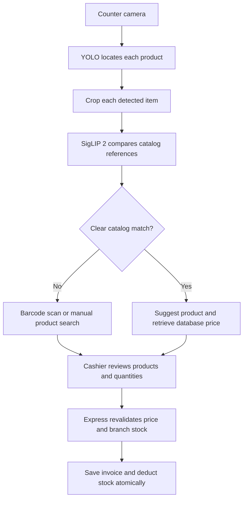

# Aspire AI Billing: Project Goals & AI Roadmap

## Project goal

Build a retail checkout system that recognizes products placed on a counter, prepares a bill for cashier confirmation, and updates the correct store's inventory.

The aim is to reduce repetitive scanning and billing work while giving administrators a clear view of stock, sales and cashier activity across branches.

**Intended workflow:** Place products → recognize items → review the bill → confirm payment method → save the invoice and deduct branch stock.

## Current system and planned AI

| Available now | Planned next |
| --- | --- |
| Single-product matching and calibrated multi-region review | Reliable physical multi-product detection |
| Inventory-linked reference photos and an experimental trained YOLO candidate | Reviewed physical training images and deployment validation |
| Webcam/RTSP frame capture and barcode/QR backup | Automated quantity handling and duplicate tracking |
| Separate branch stock and admin stock transfers | Calibrated automatic rejection of unknown products |
| Searchable invoices, reprinting and PDF | Broader evaluation on independent checkout scenes |
| Bulk retailer imports, cached AI indexing and catalog search | Broader validation on independent product photos |

**AI image matching is now connected to billing.** Admins enroll reference photos; cashiers review suggested inventory products before adding one unit. Single-product inference uses the complete image. Multi-product mode separates foreground regions against a calibrated counter. The generic YOLO model remains diagnostic; the synthetic-data-trained candidate is not automatically activated. See [AI setup](AI-RECOGNITION.md) and [application results](AI-APPLICATION-TEST-RESULTS.md).

## Why YOLO and SigLIP 2?

These models have different jobs in the proposed design.

| Component | Job | Example |
| --- | --- | --- |
| **YOLO26n** | Locate products and provide a box around each visible item. | Separate a coffee sachet, biscuit packet and bottle in one frame. |
| **SigLIP 2** | Turn product crops into visual features and compare them with labeled reference images. | Suggest the catalog entry matching a particular biscuit packet. |
| **MongoDB + Express** | Supply trusted product details, prices, discounts and branch stock. | Retrieve the price for the matched product ID. |
| **Cashier** | Confirm or correct products and quantities before completing a sale. | Replace a mistaken match or remove an extra item. |

The local matching service is implemented using admin-enrolled product references. Generic pretrained weights still need those catalog references and do not automatically identify every Pakistani grocery SKU.

### YOLO: locate the items

- Starting checkpoint: `models/detector/yolo26n.pt`.
- Fine-tune on checkout images with reviewed boxes around product packets and bottles.
- A shared `retail_product` class can locate items; SigLIP 2 can handle catalog identification afterward.
- Detection must be evaluated for small packs, similar packaging, occlusion and mixed products.

[Official YOLO detection documentation](https://docs.ultralytics.com/tasks/detect/).

### SigLIP 2: suggest the matching product

- Starting model: `google/siglip2-base-patch16-224`, prepared locally under `models/siglip2/`.
- Store several reference photos for every exact product, size and flavor, linked to its MongoDB product ID.
- Initially keep model weights unchanged and build a reference-image index.
- Compare new crops with those references; fine-tune the encoder only if evaluation shows it is necessary.
- Adding references is indexing, not model training. Similarity scores are not validated confidence percentages.

[Google's SigLIP 2 model card](https://huggingface.co/google/siglip2-base-patch16-224).

## Target multi-product detector flow

Live recognition also needs duplicate prevention: a product remaining in view must not be added repeatedly. Multiple copies and quantities require explicit handling and cashier review.

## How prices work

**The admin sets prices in MongoDB. Neither model learns or decides the selling price.**

| Example product | Example price | Source |
| --- | --- | --- |
| Mahmood Cappuccino 25g | Rs 250 | Admin-managed catalog |
| Innovative Choc n Chip | Rs 10 | Admin-managed catalog |
| LU Tiger Biscuits | Rs 10 | Admin-managed catalog |

These are supplied project examples, not current market quotations.

- Recognition returns a product ID; the backend looks up its current price and discount.
- A price change does not require retraining either model.
- Sales deduct stock only from the cashier's selected store.
- Existing invoices retain their original prices and store details.

## Pakistani product dataset

1. Register each exact product and barcode in the catalog.
2. Capture multiple views, distances, lighting conditions and packaging variations.
3. Review product boxes for YOLO and associate reference crops with catalog IDs for SigLIP 2.
4. Include empty counters, unknown products, overlapping items and multiple copies.
5. Keep training, validation and test captures separate by recording session or physical pack.
6. Evaluate using new images and live-camera scenes that were not used as references.

Automatic capture and labeling can assist data collection; labels still need review before training.

## Evidence and next steps

The existing three-product experiment exposed detector misses. SigLIP 2 ranked the supplied product descriptions first in a small closed-choice test; this does not establish production accuracy.

| Stage | Deliverable |
| --- | --- |
| **1. Retail foundation** | Existing billing, branch inventory, account controls and reporting. |
| **2. Recognition pilot** | A reviewed dataset and reference index for 5–10 exact products. |
| **3. Model evaluation** | Measure missed items, wrong matches, unknown rejection, quantity errors and latency. |
| **4. Assisted AI checkout** | A local Python inference service returning candidates to the MERN app. |
| **5. Expansion** | Broaden the catalog only after independent and live-camera checks pass. |

Success means correct products and quantities, reliable branch stock, preserved receipts and a useful checkout speed improvement measured against the current barcode workflow.

## Further reading

- [Application overview and screenshots](../README.md)
- [Detailed training proposal](../models/TRAINING-PROPOSAL.md)
- [Model preparation](../models/README.md)
- [Recorded three-product experiment](../models/product-pilot/README.md)
- [Setup and operations](OPERATIONS.md)

See [current evaluation](MODEL-EVALUATION.md) and [GPU training](GPU-DETECTOR-TRAINING.md) for measured results and remaining limitations.
